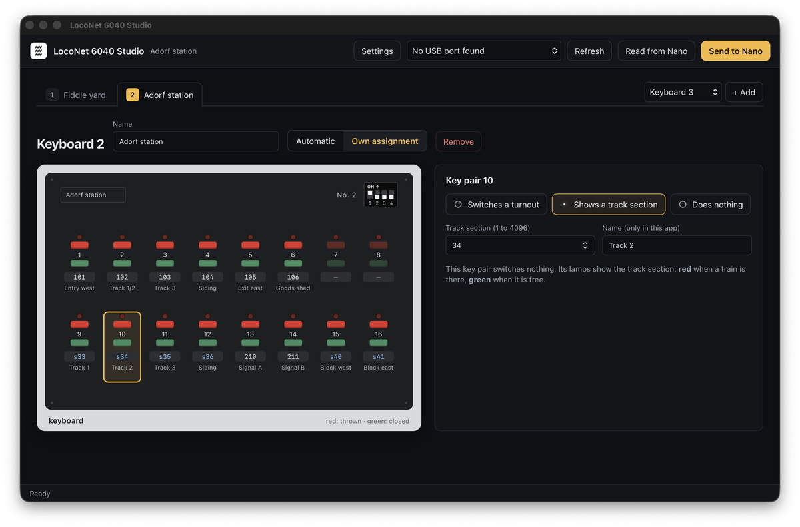
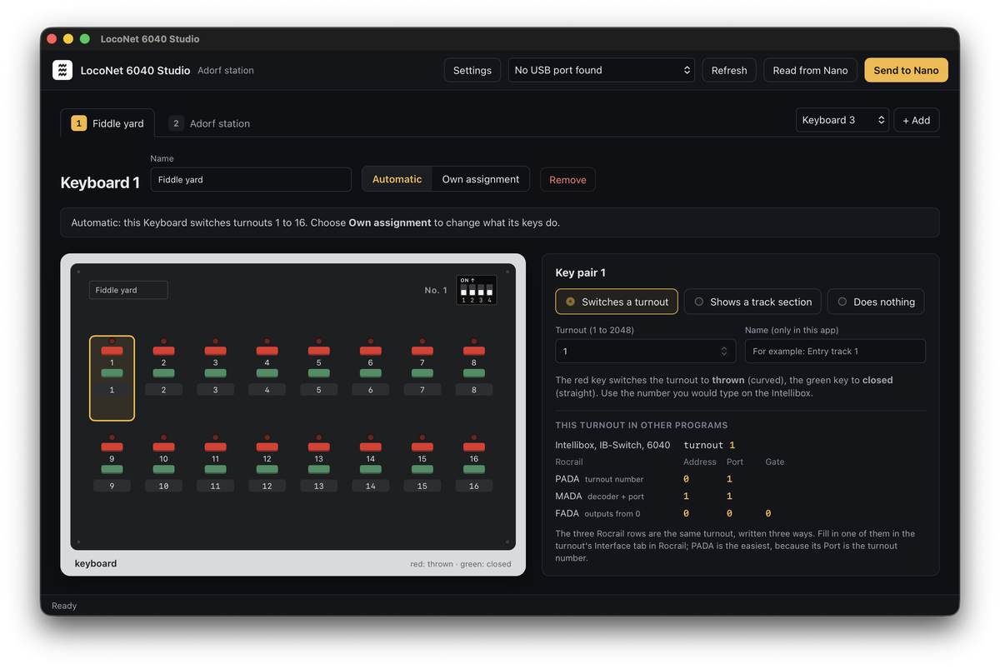
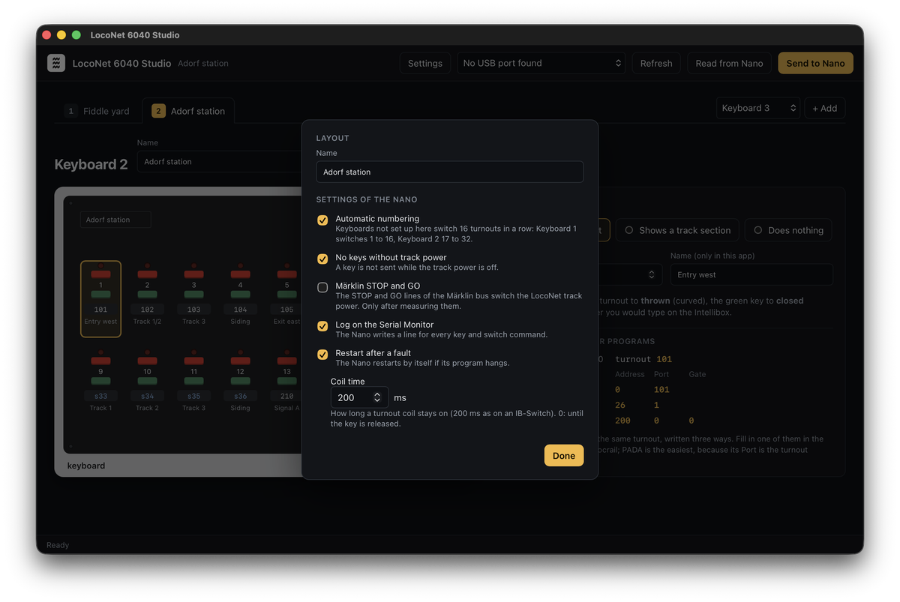

# LocoNet 6040 Studio

<p align="center">
  
</p>

**Set up your Märklin Keyboards 6040 on LocoNet with the mouse instead of typed commands.**


LocoNet 6040 Studio is the setup program for [Marklin-6040-LocoNet](https://github.com/CuriousTimo/Arduino-ModelRail/tree/master/Marklin-6040-LocoNet): an Arduino Nano that lets unmodified Märklin Keyboards 6040 work on LocoNet, like an Uhlenbrock IB-Switch. In the Studio you see your Keyboards as they look on the layout, click a key pair and choose what it does. Then you send the setup to the Nano over its USB cable.

> **Beta, not yet tested with a real Nano.** Version 0.1.0 has been built and its file handling tested on a computer, but not yet used with a Nano and real Keyboards. Test reports are very welcome.

## What it does

- **Your Keyboards as you know them:** each Keyboard 6040 with its 16 key pairs in two rows of 8, red above green, numbered as on the Keyboard.
- **One tab per Keyboard**, above the picture, with **+ Add** for the next one.
- **Click a key pair and choose:** it switches a turnout (1 to 2048), it shows a track section (red occupied, green free), or it does nothing. Give it a name, such as "Entry track 1", so you still know what it was for next year.
- **Read from Nano:** takes over the setup that is on the Nano now.
- **Send to Nano:** puts your setup on the Nano and then reads it back to check that the Nano really has it.
- **Save and open** your setup as a file on the computer, with all its names. That is also your backup: if a Nano is replaced, open the file and send it to the new one.
- **Rocrail's MADA, PADA and FADA explained:** for every turnout the Studio shows the same turnout as the Intellibox numbers it and as Rocrail's three ways of writing it, exactly as you fill them in Rocrail's Address, Port and Gate fields. PADA is the easiest: Address 0, and the turnout number as Port.
- **Settings** (top right): the layout's name and the settings of the Nano (automatic numbering, coil time, no keys without track power, and the others), each with a plain explanation.
- **Export backup:** the setup as the list of commands the Nano understands, the same text as its `backup` command, to keep or to type in on the Serial Monitor.
- **Export KeyMap.h:** the setup as a file for the Arduino IDE, for those who load the program themselves.

## A look inside

The picture at the top shows Keyboard 2, "Adorf station", with key pair 1 selected: it switches turnout 101, and on the right you see the same turnout as Rocrail's PADA, MADA and FADA. Next to the Keyboard's number, the four switches on its back are drawn as they must be set.

| | |
| --- | --- |
|  |  |
| **A track section.** Key pair 10 shows track section 34: its lamps are red while a train is there, green when the track is free. | **Automatic numbering.** Keyboard 1 switches turnouts 1 to 16 without any setup; all four switches on its back are off. |



**Settings.** The layout's name and the settings of the Nano, each with a plain explanation. Most layouts never change them.

## How to use it

1. Connect the Nano with its USB cable.
2. Start LocoNet 6040 Studio. At the top right, choose the Nano's USB port (press **Refresh** if it is not in the list).
3. Press **Read from Nano** to start from what the Nano has now, or start with an empty layout.
4. Choose a Keyboard with the tabs above the picture, or add one with **+ Add**. Its number is the one set with the four switches on the back of the Keyboard, 1 to 16 as in Märklin's table; the Studio draws the switches next to the number.
5. Choose **Own assignment**, click a key pair and choose what it does. The key pairs are numbered as on the Keyboard: 1 to 8 in the top row, 9 to 16 in the bottom row.
6. Press **Send to Nano**. The Studio tells you when the Nano has the setup.
7. **Save** the layout (File → Save) to keep it.

The Nano restarts each time the Studio connects to it; that takes about two seconds and is normal.

## Download

Download the installer for your computer from the [Releases](https://github.com/CuriousTimo/LocoNet-6040-Studio/releases) page (there are none yet; until then, build it from the source code below):

- **Windows:** `LocoNet 6040 Studio_x.y.z_x64-setup.exe`. Windows may warn that the program is from an unknown publisher: choose **More info → Run anyway**.
- **macOS:** the `.dmg` for Apple Silicon (`aarch64`, Macs from 2020 on) or Intel (`x64`). Open it and drag LocoNet 6040 Studio to Applications.
- **Linux:** `.deb` (Debian, Ubuntu, Raspberry Pi OS) or `.rpm` (Fedora, openSUSE).

### The first start on a Mac

The Studio is a free hobby program without a paid Apple developer certificate, so the first time macOS says it cannot check the app ("unidentified developer"). The app is fine; you only need to allow it once:

1. Double-click LocoNet 6040 Studio. macOS shows the warning; click **Done** (or **OK**).
2. Open **System Settings → Privacy & Security** and scroll down. Next to "LocoNet 6040 Studio was blocked", click **Open Anyway**, and confirm with your password.
3. From then on it starts like any other program.

On macOS 14 (Sonoma) and older, right-clicking the app and choosing **Open** does the same.

## Building from source

You need [Rust](https://rustup.rs). On Linux also the libraries Tauri needs (`libwebkit2gtk-4.1-dev`, `libappindicator3-dev`, `librsvg2-dev`, `patchelf`) and `libudev-dev`.

```sh
cargo test -p l6040-core                  # the layout, backup and KeyMap.h code
cargo run -p loconet-6040-studio          # start the app
cargo run -p loconet-6040-studio -- "examples/Adorf station.json"   # start with the example
cargo run -p loconet-6040-studio -- "examples/Adorf station.json" --keyboard 2 --pair 10 --settings
                                          # start on a Keyboard and key pair, for screenshots
cargo install tauri-cli --version "^2"    # once, for installers
cd app/src-tauri && cargo tauri build     # installers in target/release/bundle
```

The code:

| Folder | What is in it |
| --- | --- |
| `crates/l6040-core` | The layout, reading and writing the Nano's `backup` text, comparing a layout with the Nano, `KeyMap.h` |
| `app/src-tauri` | The app: windows, menus, files, and the USB connection to the Nano (`nano.rs`) |
| `app/ui` | What you see: plain HTML, CSS and JavaScript |

The Studio talks to the Nano with the same commands a person types on the Serial Monitor (`backup`, `keys`, `clear`, `option`), one at a time, waiting for each answer. See the firmware's README for the commands.

## Planned

- Installers signed with an Apple Developer ID and a Windows certificate, so the warnings above go away

- Loading the Marklin-6040-LocoNet program onto a new Nano from the Studio, without the Arduino IDE
- Ready-made downloads for Windows, macOS and Linux
- A test view: see each key press and switch command live while the Nano is connected
- Printing labels for the strips above the keys of a Keyboard 6040

## License

[Apache License 2.0](LICENSE). The logo is the logo of Losse Eindj.es by Curious Timo.

Märklin is a trademark of Gebr. Märklin & Cie. GmbH, Uhlenbrock and Intellibox of Uhlenbrock Elektronik GmbH. This is an independent hobby project.
